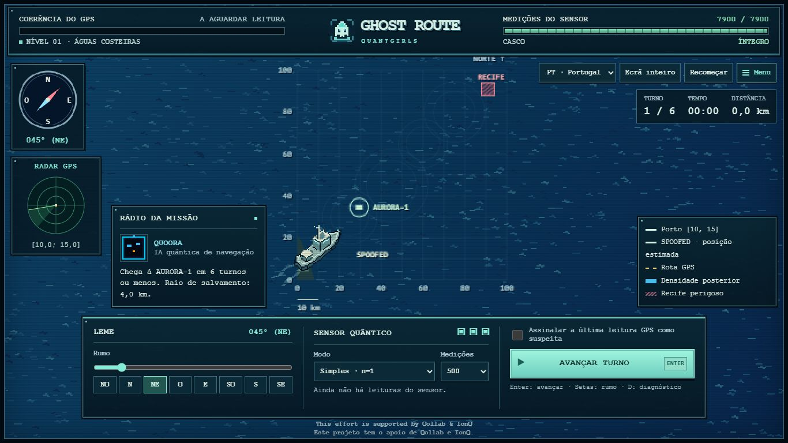

# Ghost Route 

A fullscreen navigation game with 32-bit-era pixel art by QuantGirls for the Qollab × IonQ hackathon. Rescue the Aurora-1 crew aboard **SPOOFED**, navigate around a reef and rock fields, and identify deceptive GPS readings with Quoora's simulated quantum sensor.

The name **Ghost Route** stays the same in every language. The complete interface, dialogue, alerts, menus and replay controls support **BR · Português (Brasil)**, **PT · Português (Portugal)**, **IN · English** and **ES · Español**. Brazilian Portuguese is the default.

Ghost Route has its own nautical identity: a pixel ship emblem, a cyan-and-amber bridge interface, a mission menu and 32 direction-specific views of SPOOFED. The ship's bridge and mast keep their perspective as it turns.

This effort is supported by Qollab & IonQ



Play the published frontend at [ghostroutegame.vercel.app](https://ghostroutegame.vercel.app/). The Qollab project and submission remain separate steps described in [the submission checklist](docs/submission-checklist.md).

## Play locally

Open [public/index.html](public/index.html) in a browser. Keep the `public/assets/` folder beside it. The frontend has no external runtime dependencies or build step.

Alternatively, serve the public folder from the repository root:

```sh
python -m http.server 8000 --directory public
```

Open http://localhost:8000. Start with **level 00**, a guided four-turn voyage, or choose a level from the mission menu. The campaign contains **100 levels, numbered 00–99**, with missions lasting 4–12 turns. Each level has a unique localized name. Early voyages gradually grow from 4 to 12 turns and cross more of the chart. Rocks and gentle currents start at level 01, GPS jumps at 03, GHZ at 06, the central reef / blackout / GPS drift at 10, and GPS freeze at 30. Budget guidance appears at 60; currents strengthen while budgets and rescue radii decrease. First-use introductions also work when choosing an advanced level directly; `tests/campaign.cjs` proves every level still admits a safe rescue. The menu shows each level's measurement budget and rescue radius before you start. Use the heading controls, select a sensor mode and measurement budget, then advance. See [the game guide](docs/game-guide.md) for controls, campaign progress and replay.

Language, selected level, completed levels, sound preference and acknowledged mechanic introductions are saved in this browser when local storage is available. The game remains playable when storage is restricted. Progress belongs to the current browser and origin; it does not synchronize between devices.

Original synthesized sound effects accompany sensor readings, navigation without the sensor, suspicious marks, introductions, alerts, rescue and failure. Toggle **Sound** in the mission menu. Audio starts after user interaction, needs no downloaded assets and is optional when unavailable.

The full-resolution chart adds finer ocean reflections and rock facets while retaining crisp pixel edges. “32-bit” describes the art direction; the frontend runs in a browser.

## Quantum model and execution

The browser draws offline samples from the Ramsey Born probabilities. It does **not** run Qiskit or submit hardware jobs.

[main.py](main.py) is the **Qollab Run entry point**. It uses the backend supplied by the platform to submit one combined eight-qubit circuit, with separate groups for simple and GHZ sensing in the X and Y bases. This entry point demonstrates the circuit model; it does not run the web frontend. The reusable quantum model and sensor functions live in [sensor.py](sensor.py). The browser and Python share the formulas

```text
P_X(1 | φ, n) = (1 − cos(nφ)) / 2
P_Y(1 | φ, n) = (1 − sin(nφ)) / 2
```

where `n=1` is the simple sensor and `n=3` is GHZ. GHZ changes the phase response and creates three possible phases; it does not provide an unambiguous position. A Bayesian grid combines measurements with predicted movement.

JavaScript and Python use different random-number generators. Replaying an exported session in Qiskit takes **fresh samples** at the saved phases; identical seeds do not imply identical counts. Saved positions and phases are references, not a second physics trajectory generated from the browser seed.

## Install and test Python

From the repository root:

```sh
python -m venv .venv
```

Activate `.venv` for your operating system, then run:

```sh
python -m pip install -r requirements.txt
python sensor.py
python -m pytest tests -q
python scripts/plot_fringes.py
```

On Windows, [scripts/setup_and_test.bat](scripts/setup_and_test.bat) provides the setup and test workflow. The fringe figure belongs at [docs/assets/ramsey-fringes.png](docs/assets/ramsey-fringes.png).

JavaScript checks require Node.js and no package installation:

```sh
node tests/game-core.cjs
node tests/estimator.cjs
node --test tests/localization.cjs
node tests/ui-state.cjs
node tests/campaign.cjs
node tests/ship-rendering.cjs
node tests/map-layout.cjs
node tests/experience.cjs
```

## Replay with Qiskit

```sh
python scripts/replay_session.py examples/session-seed-20261011.json
```

You can pass your own exported session instead. Campaign exports include their mission configuration, including the selected level, turn limit, rescue radius, reef and rocks (`pedras`). Add `--validate-only` to inspect a session without sampling, or `--output dist/replay-report.json` to save a report. The script batches the session's circuit PUBs into **one sampler.run call**, using the saved world and phases as reference. It compares fresh circuit sampling with the same analytical model. The supplied `examples/session-seed-20261011.json` preserves the original twelve-turn mission. Local execution does not demonstrate a completed Qollab run.

## Deploy the web game on Vercel

Import [this GitHub repository](https://github.com/SouBeatrizKaroline/QollabQuantumHackathon_GhostRoute) and select:

- Framework preset: **Other**
- Root directory: repository root
- Build command: empty
- Output directory: **public**

The root `vercel.json` declares a static deployment. No frontend environment variables are needed. Vercel hosts the browser game; it does not execute the Python sensor.

## Prepare a Qollab package

```sh
python scripts/package_qollab.py
```

The generator prepares ignored `dist/qollab/` and `dist/ghost-route-qollab.zip`, including root `main.py` and `sensor.py`. These are generated deliverables, not another tracked source tree. Use the generated files with Qollab's current project workflow and confirm the platform's Run execution before submission. The presence of the entry point and successful local tests do not establish that a Qollab run has occurred.

## Repository layout

```text
main.py                           Qollab Run entry point with injected backend
sensor.py                         Reusable Python/Qiskit sensor model
requirements.txt                  Python dependencies
vercel.json                       Static deployment of public/
public/index.html                 Browser game loader
public/assets/css/game.css        Responsive bridge interface
public/assets/js/engine.js        Physics, estimation and rendering
public/assets/js/i18n.js          Complete en, pt-BR, pt-PT and es catalogs
public/assets/js/audio.js         Original synthesized effects and mute
public/assets/js/onboarding.js    Level names and mechanic introductions
public/assets/js/app.js           Game controller and interaction
public/assets/js/console-decor.js Bridge console cables, buttons and screws (desktop)
tests/                            Sensor and browser-logic checks
scripts/                          Setup, plotting, replay and packaging
examples/session-seed-20261011.json
docs/                             Guide, submission notes and demo script
docs/assets/ramsey-fringes.png
dist/                             Generated output; ignored by Git
```

[QA report](docs/qa-report.md) · [Project-page draft](docs/project-page.md) · [Demo script](docs/demo-script.md) · [Submission checklist](docs/submission-checklist.md) · [Hackathon references](docs/hackathon-research.md) · [Git guide](docs/git-guide.md)

MIT License — QuantGirls Team. AI assistance: Gemini Spark assisted the initial implementation; OpenAI Codex assisted the fullscreen interface, procedural sprites, localization, QA and repository organization. Claude (Anthropic) assisted the sunset colour theme, animated map effects, particles, the full-resolution 32-bit ship sprite and the bridge cockpit console. User-provided visual references guided the art direction. Review the final disclosure against the team's actual contribution history before submission.
