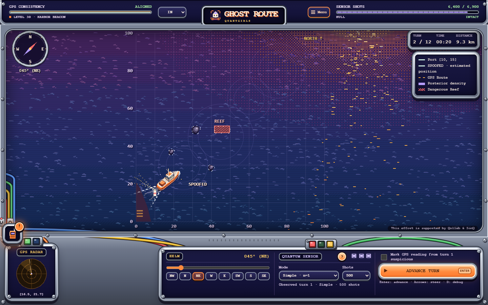

# Ghost Route

**English** · [Português (Brasil)](README.pt-BR.md) · [Português (Portugal)](README.pt-PT.md) · [Español](README.es.md)

> **This effort is supported by Qollab & IonQ**

**Team: QuantGirls**

- Beatriz Karoline Cordeiro da Silva · [Portfolio](https://soubeatrizkaroline.vercel.app/)
- Daiane Fonseca · [LinkedIn](https://www.linkedin.com/in/daiane-fonseca-552655285)
- Sonia Janara Silva Barros · [Portfolio](https://jhay.goskip.app/)

**For judges and readers:** [What the project does](#the-problem-and-our-contribution) · [How to run it](#play-locally-without-a-build-step) · [Credits and disclosure](#credits-and-development-transparency) · [References](#references-and-external-attribution)

### When your GPS lies, how will you bring them home?

**A pixel-art rescue adventure that turns quantum sensing into a decision you can play.**

Aurora-1 is returning from orbit. You are at the helm of **SPOOFED**, with a crew to rescue, dangerous waters ahead and navigation signals you cannot always trust. Your ally is **Quoora**, an onboard AI that helps you compare the GPS with a simulated quantum sensor. Choose your heading, question the signal and bring everyone home.

**[Play Ghost Route](https://ghostroutegame.vercel.app/)** · [Learn to play](docs/game-guide.md) · [Explore the project](docs/project-page.md) · [Technical guide](docs/technical-guide.md)

*Actual gameplay capture. Desktop and mobile layouts share the same campaign.*

## The problem and our contribution

GPS can provide misleading position information when its signal is manipulated, a practice called **spoofing**. Ghost Route turns that problem into an accessible rescue game: players compare navigation clues, choose when to measure and learn how uncertainty changes a decision.

Our contribution is the integration of established sensing ideas into a playable story, campaign, interface and replay. The scientific principles and software tools are credited below. **The browser game is an educational simulation; the separate Python project demonstrates quantum circuits.** It is not a navigation device for real vessels.

For educators, the prototype offers a way to discuss uncertainty and quantum sensing through play. For partners and investors, the next proposed step is an educational pilot with measurable learning outcomes. Revenue, market demand and learning gains have not yet been demonstrated.

## A hundred missions. One question: which signal do you trust?

| What you get | Why it matters |
| --- | --- |
| **100 named levels, 00–99** | Start with a four-turn tutorial, then face gradually tighter navigation challenges. |
| **A simulated quantum sensor** | Compare evidence, manage measurements and discover why greater phase sensitivity comes with ambiguity. |
| **32-bit-era pixel art** | A nautical bridge, sunset seas and 64 directional ship views that keep the mast upright. |
| **A walkie-talkie mission radio** | Click the icon to read messages. New messages glow; alerts stay clear of the helm. |
| **Original sound effects** | Hear measurements, warnings, rescue and failure; mute them from the menu. |
| **Four languages** | English, Brazilian Portuguese, European Portuguese and Spanish, including tutorials and replay. |
| **Replay and decision export** | Review your route, suspicious readings and sensor choices after each mission. |

## Your first rescue takes four turns

1. Open the game and choose **level 00**.
2. Keep a **045° northeast heading** and follow Quoora's four tutorial steps.
3. Select the **Simple** sensor, advance, compare the instruments and reach Aurora-1.
4. Review the result and move to the next level.

New mechanics are introduced before use, even if you choose a later level directly. Currents, rocks, narrower passages and limited measurements gradually make decisions harder. Some later missions use reef walls and sandbanks with an opening to navigate through. A false “ghost Aurora” can appear when GPS is deceptive; players compare the simulated sensor estimate with GPS to find the real capsule. See [campaign progression](docs/campaign-design.md) for the detailed rules.

## Choose your way into the project

| You are here to… | Start here |
| --- | --- |
| **Play or discover quantum ideas without equations** | [Player guide](docs/game-guide.md) |
| **Judge the project or understand its contribution** | [Project overview](docs/project-page.md) and [demo script](docs/demo-script.md) |
| **Explore educational or partnership potential** | [Product vision and next steps](docs/project-page.md#product-vision) |
| **Build, reproduce results or contribute** | [Technical guide](docs/technical-guide.md) and [verification report](docs/qa-report.md) |

## Quantum science, explained through play

Think of the sensor as another source of clues. It samples a model of magnetic fingerprints and combines those readings with the ship's movement to estimate possible positions. **GHZ** mode uses three entangled qubits (linked quantum units) and responds to three times the phase, but leaves three candidate phases. Here, phase is the angle encoded by the simulated magnetic signal. A sharper response is not an automatic, unambiguous position fix.

The browser runs an **educational simulation**. A separate Python implementation uses **Qiskit circuits**, and a Qollab entry point demonstrates both sensor modes in one eight-qubit circuit. This prototype does not establish real-world navigation performance or a demonstrated quantum advantage. [See the model and execution paths](docs/technical-guide.md).

## Play locally, without a build step

Open [public/index.html](public/index.html) in your browser, keeping its assets folder beside it. No frontend installation is required. For a local server:

~~~sh
python -m http.server 8000 --directory public
~~~

Open **http://localhost:8000**. Sound starts after user interaction. The game defaults to **BR**; select **IN** for English, **PT** for European Portuguese or **ES** for Spanish. Progress and preferences are saved in the current browser when storage is available.

## Run the quantum circuit demonstration

From the repository root, use **Python 3.10 or newer**:

~~~sh
python -m venv .venv
~~~

Activate the environment: Windows: `.venv\Scripts\activate`; macOS/Linux: `source .venv/bin/activate`.

~~~sh
python -m pip install -r requirements.txt
python sensor.py
~~~

This local demonstration compares Simple and GHZ phase estimates using Qiskit's simulator and prints a circuit. **It does not run on IonQ hardware.**

For Qollab, generate the distribution with `python scripts/package_qollab.py`. Keep `main.py`, `sensor.py` and `requirements.txt` at the project root, include the license and documentation, select the backend in Qollab and run its entry point. `main.py` expects the backend supplied by that platform; `python main.py` is not the local demo. It combines both modes and X/Y readouts into one eight-qubit circuit and one job. See the [technical guide](docs/technical-guide.md) and [official runtime documentation](https://qollab.xyz/learn/docs/runtime-environment) for setup and reproduction.

## Built to be played, inspected and extended

The project combines a playable campaign, explicit sensing tradeoffs and inspectable decisions. Frontend checks cover mission rules, localization, estimation, rendering and safe rescue routes across the campaign. Platform execution and submission evidence are tracked separately in the [submission checklist](docs/submission-checklist.md).

**Created by QuantGirls for the Qollab × IonQ hackathon.** Released under the [MIT license](LICENSE). Educational pilots, more accessible onboarding and comparative evaluation are proposed next steps; commercial traction and learning outcomes have not been established.

## Credits and development transparency

The project combines the team's game design and integration with established scientific methods, software dependencies and AI-assisted development. The following assistance is recorded in the repository:

| Contributor or source | Recorded use |
| --- | --- |
| **QuantGirls** | Project design and integration of the rescue narrative, campaign, sensing choices, interface and replay. |
| **Gemini Spark** | Assistance with the initial implementation. |
| **OpenAI Codex** | Assistance with the interface, procedural art, localization, QA, campaign refinement and documentation, including this README revision. |
| **Claude (Anthropic)** | Assistance with the sunset theme, animated map effects, ship sprite and cockpit console. |
| **User-provided visual references** | Art-direction inspiration; individual origins and any reuse still need team confirmation. |
| **Qiskit, NumPy and Matplotlib** | External Python dependencies; Pytest supports testing. See [requirements.txt](requirements.txt) and the official references below. |
| **Playwright** | Optional browser checks; not required to play. |

Scientific citations identify the foundations of the model. They do not establish that any paper's code, a tutorial's circuit or another repository's text was copied, or that Ghost Route reproduces Q-CTRL's implementation. If code, circuit designs, written explanations, images or templates were copied or adapted, disclose the source, author, affected files, nature of reuse and applicable license alongside the relevant material. A general bibliography does not replace that disclosure.

**Disclosure still requiring team confirmation:** the exact contribution dates and build-window work; any pre-existing code or templates; specific origins of visual references; and any copied or adapted external material beyond the sources already recorded here. This README does not certify that the reuse inventory is complete.

## References and external attribution

The full list below brings the references already recorded in the repository into the main README. [Scientific basis and source-to-code mapping](docs/scientific-basis.md) explains their use in more detail.

| External foundation | Use in Ghost Route |
| --- | --- |
| **Ramsey interferometry — [1]** | Superposition, phase encoding and X/Y readouts in [sensor.py](sensor.py). |
| **GHZ states and phase estimation — [2–4]** | Three-qubit phase response and multiple candidate phases. Greater sensitivity alone does not prove better positioning. |
| **Magnetic navigation — [5], Q-CTRL and research-trail links** | Inspiration for independent navigation evidence. The game's maritime map is synthetic. |
| **Classical probabilistic localization — [6]** | Movement prediction and measurement updates in the Bayesian grid estimator in [engine.js](public/assets/js/engine.js). |

### Scientific bibliography

1. **Ramsey, N. F. (1950).** *A Molecular Beam Resonance Method with Separated Oscillating Fields*. Physical Review 78, 695–699. [DOI: 10.1103/PhysRev.78.695](https://doi.org/10.1103/PhysRev.78.695).
2. **Greenberger, D. M.; Horne, M. A.; Zeilinger, A. (1989).** *Going Beyond Bell's Theorem*, in *Bell's Theorem, Quantum Theory and Conceptions of the Universe*, pp. 69–72. [Author-deposited reprint, arXiv:0712.0921](https://arxiv.org/abs/0712.0921) (uploaded in 2007; original chapter: 1989).
3. **Bollinger, J. J.; Itano, W. M.; Wineland, D. J.; Heinzen, D. J. (1996).** *Optimal frequency measurements with maximally correlated states*. Physical Review A 54, R4649. [DOI: 10.1103/PhysRevA.54.R4649](https://doi.org/10.1103/PhysRevA.54.R4649).
4. **Meyer, V. et al. (2001).** *Experimental Demonstration of Entanglement-Enhanced Rotation Angle Estimation Using Trapped Ions*. Physical Review Letters 86, 5870–5873. [DOI: 10.1103/PhysRevLett.86.5870](https://doi.org/10.1103/PhysRevLett.86.5870).
5. **Muradoglu, M. et al. (2025).** *Quantum-assured magnetic navigation achieves positioning accuracy better than a strategic-grade INS in airborne and ground-based field trials*. [arXiv:2504.08167v1, 10 April 2025](https://arxiv.org/abs/2504.08167v1). Primary research preprint; identifies the actual field trials.
6. **Fox, D.; Burgard, W.; Thrun, S. (1998).** *Markov Localization for Reliable Robot Navigation and People Detection*. [Author institution, Carnegie Mellon University](https://publications.ri.cmu.edu/markov-localization-for-reliable-robot-navigation-and-people-detection). Classical probabilistic localization reference.

### Research trail supplied by the team

- **Q-CTRL.** [Delivering quantum advantage to airborne systems](https://q-ctrl.com/case-study/q-ctrl-delivering-quantum-advantage-to-airborne-systems). Company case study; engineering inspiration, not validation of Ghost Route.
- **Swayne, M. (14 April 2025), The Quantum Insider.** [Q-CTRL Overcomes GPS-denial With Quantum Sensing, Reports Quantum Advantage](https://thequantuminsider.com/2025/04/14/q-ctrl-overcomes-gps-denial-with-quantum-sensing-reports-quantum-advantage/). Secondary news/press-release coverage.
- **InnovationAus.** [Q-CTRL claims 'quantum advantage' with GPS-free navigation](https://innovationaus.com/?p=66343). Team-supplied research link; inaccessible during this review, so not used to support technical claims.

### Software and platform references

- **Qollab:** [Process and FAQ](https://qollab.xyz/programs/hackathon/how-it-works), [hackathon terms](https://qollab.xyz/programs/hackathon/terms), [registration](https://qollab.xyz/programs/hackathon/register) and [runtime environment](https://qollab.xyz/learn/docs/runtime-environment).
- **Qiskit:** [official documentation](https://quantum.cloud.ibm.com/docs/) and [primitive inputs and outputs](https://quantum.cloud.ibm.com/docs/en/guides/primitive-input-output). Circuit construction and local sampling.
- **NumPy:** [official documentation](https://numpy.org/doc/). Numerical support for the Python tools.
- **Matplotlib:** [official documentation](https://matplotlib.org/stable/). Model plots.
- **Pytest:** [official documentation](https://docs.pytest.org/). Python verification.
- **Playwright:** [official documentation](https://playwright.dev/docs/intro). Optional browser verification.
- **Vercel:** [build configuration](https://vercel.com/docs/builds/configure-a-build). Hosting configuration for the browser game.

### Hackathon submission status

The required support attribution is displayed at the top of this README. References and recorded AI/dependency credits are visible without expanding a hidden section.

The **Qollab project URL, actual backend-run evidence and public demo video** still require team confirmation in the repository's [submission checklist](docs/submission-checklist.md). Confirm the contribution chronology and reuse inventory before submission. A playable web demo and local checks do not by themselves establish platform execution or formal submission. Consult the current official terms for the complete requirements.

### License

The project is distributed under the [MIT license](LICENSE), which also retains the required support attribution. External dependencies and any reused material retain their respective licenses and attribution requirements.
