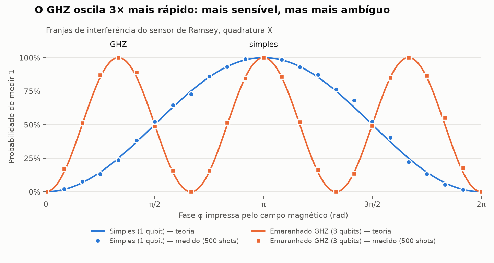

# Rota Fantasma

> A navigation game where your GPS is lying to you, and the only honest instrument is a quantum sensor.

**Team:** QuantGirls · **Event:** Qollab x IonQ Quantum Hackathon (Oct 9–11, 2026) · **Theme:** Quantum Playground

A ship crosses a zone where its GPS is being spoofed. The player can't see the truth directly: the only reliable source is a quantum magnetometer, implemented as a real Ramsey interferometer in Qiskit. The Earth's magnetic field at the ship's true position becomes a phase on the qubit, and only measurement statistics reveal it. At the end, a replay shows the real route, the route the lying GPS showed, and every quantum reading.

## Status

| Stage | What it delivers | Status |
| --- | --- | --- |
| Demo 1 | Quantum sensor: single-qubit and GHZ circuits, X/Y quadratures, phase estimation | ✅ Done |
| Demo 2 | Game world: magnetic map, ship, inertial estimate, 3 spoofing attacks | In progress |
| Alpha | Estimator: position heatmap and spoofing alert | Planned |
| Beta | Final replay, missions (incl. splashdown rescue), scoring | Planned |
| Omega | Qollab page, accessibility pass, demo video | Planned |

## How the quantum sensor works

1. **Field becomes phase.** The magnetic field at the ship's true position rotates the qubit's phase by φ.
2. **Ramsey interferometer.** `H → Rz(φ) → H → measure`. The probability of measuring 1 is sin²(φ/2).
3. **Two quadratures (X and Y)** recover the full phase via `atan2`, not just its cosine.
4. **GHZ mode (n entangled qubits)** accumulates n·φ: n times more sensitive, but with n candidate phases (fringe ambiguity). This is the real trade-off of entanglement-enhanced sensing, and it becomes a tactical decision in the game.
5. **IonQ constraint:** one job per run, so all readings of a turn are packed into a single circuit, each with its own qubits and classical register.



## Run it

```bash
pip install -r requirements.txt
python sensor.py          # candidate phases + circuit diagram
python -m pytest          # 14 tests
python grafico_franjas.py # generates franjas.png
```

On Windows you can just double-click `instalar_e_testar.bat`.

To run on IonQ's simulator inside Qollab, pass that backend's sampler to `rodar(..., sampler=...)` in `sensor.py`.

## Files

| File | Purpose |
| --- | --- |
| `sensor.py` | Ramsey/GHZ circuits, single-job packing, phase estimation |
| `test_sensor.py` | Measurements match theory; estimation recovers the phase |
| `grafico_franjas.py` | Interference-fringe chart (theory vs. measured) |
| `instalar_e_testar.bat` | Windows one-click setup and test |

## Tools and credits

AI assistance (Claude) was used for brainstorming, code drafting and documentation; all code was reviewed and tested by the team. Libraries: Qiskit, NumPy, Matplotlib, pytest.

This effort is supported by Qollab & IonQ.

## License

MIT, see [LICENSE](LICENSE).
