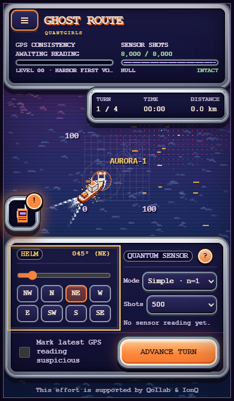

# Player guide

**English** · [Português (Brasil)](pt-BR/game-guide.md) · [Português (Portugal)](pt-PT/game-guide.md) · [Español](es/game-guide.md)

**Your job: reach Aurora-1, avoid grounding and decide which GPS readings deserve suspicion.** No quantum background is needed.

## Start with level 00

Open [the game](../public/index.html) or the [online frontend](https://ghostroutegame.vercel.app/). Choose level 00 and keep the heading at **045° (NE)** for four moves. Quoora explains the helm, Simple sensor, GPS comparison and rescue. Read each introduction, acknowledge it and make the next move.

## The decision loop

1. **Steer.** Select a compass direction or drag the heading slider. North is 0°, east 90°.
2. **Measure.** Choose Off or Simple; GHZ becomes available at level 45. Select how many measurements to spend.
3. **Advance.** The ship moves one fixed distance for the selected mission, plus current uncertainty. A turn represents 20 fictional minutes.
4. **Compare.** The ship represents the estimated position; the GPS square is the reported position. Lilac density shows possible positions, not certainty.
5. **Mark.** If the displayed GPS reading looks suspicious, mark it after observing it. The checkbox belongs to the completed turn, not the next move.

Plan the entire movement segment: crossing a rock or reef grounds the ship even if the destination is clear. Reach the capsule within the briefing's rescue radius before time runs out. Rescue ends the mission as soon as you arrive.

## A gradual campaign

| First level | What changes and what to practise |
| --- | --- |
| 00 | Four guided turns: steer, read Simple, compare GPS and rescue. |
| 01–04 | Calm practice of the same skills; no obstacles, current noise, attacks or new mechanic cards. |
| 05 | Very gentle currents: measure after moving and correct course. |
| 10 | One small rock: plan a slight bend in open water. |
| 25 | First wide sandbank opening, in passage missions. |
| 35 | A short GPS jump: compare the displayed reading with the sensor. |
| 45 | Optional GHZ: greater phase sensitivity with ambiguity; Simple remains available. |
| 55 | Reef and second opening in passage missions. |
| 65 | Reentry blackout: use the predicted ellipse until the beacon returns. |
| 70 | False Aurora beacon: use independent position evidence, not appearance alone. |
| 75 | GPS drift: compare successive readings. |
| 85 | Third alternating opening in passage missions. |
| 90 | GPS freezing: check whether the reported position moves with the ship. |
| 95 | Budget reminder before the final combined challenges. |
| 99 | Strongest combined resource pressure: three narrow passages, eight rocks, three attack types and tight rescue precision. |

Levels 01–04 reinforce the sensor skills taught in level 00. New mechanics enter one at a time, with at least five levels between introductions. The destination moves gently across the chart; current uncertainty grows, measurement budgets shrink and rescue precision tightens gradually. The reference-route travel demand grows smoothly from about 70% at level 01 to 92% at level 99. This reference uses opening centers, excludes rock detours and does not measure player success or guarantee that every individual finds adjacent levels equally harder.

Terrain is explained at departure. GPS jumps, blackout, drift and freezing are introduced just before their first affected move. The ghost beacon is explained when it first becomes visible; an attack during blackout may not display it. Play pauses until the player acknowledges the card. Acknowledged mechanics are remembered; skipping to an advanced level still teaches unfamiliar mechanics at the appropriate time. The ghost is a visual GPS deception, not a second physical capsule. Approaching it does not rescue Aurora-1; success requires the real capsule within the configured radius.

Existing rock formations grow gradually instead of being randomly replaced every level. New rocks start small. The menu shows the turn limit, budget, rescue radius and a difficulty index; it is a design index, not a measured player success rate. You can choose any level, and unfamiliar mechanics are still introduced.

## Radio, sound and controls

Click the **walkie-talkie icon** to open or close messages. A glow and ! badge indicate an unread mission moment. The radio opens clear of alerts and the helm. Use **Menu → Sound** to mute or enable effects. Browser audio begins after an interaction.

With the map focused: **Enter / Space** advances; **Left / Right** changes heading by 5°; **R** restarts; **D** shows the explicitly labeled true-position debug view; **Esc** opens the menu. Input controls retain their native keyboard behavior. Fullscreen support depends on the browser.

Language codes: **IN** English, **BR** Brazilian Portuguese (default), **PT** European Portuguese, **ES** Spanish. Preferences and completed levels belong to this browser and origin. Storage restrictions do not stop play, but may prevent saving.

## Learn from the result

A safe rescue completes the level. A perfect rescue also marks at least one observed reading for each attack present in that mission; false alarms are reported separately. Replay reveals actual, GPS and inertial routes, attack timing and measurement counts. Historical replay omits posterior heatmaps because per-turn snapshots are not stored. Export saves decisions as JSON for inspection and Python circuit replay.

More measurements reduce sampling noise but use the budget. Sensor exhaustion still permits navigation. A GPS consistency warning means disagreement with the estimate; it is not a guaranteed attack detector. [Understand the model](technical-guide.md).

Help and actions in the mission menu contains the navigation guide, restart and decision export. On compact portrait screens, the main button starts the newly selected level; otherwise it continues the current mission or opens its replay.

[Sensor learning and campaign progression](campaign-design.md)
