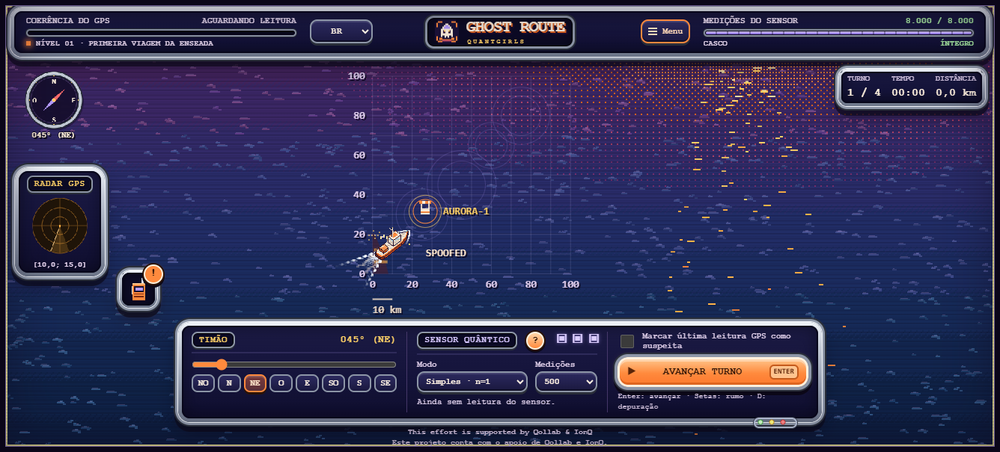
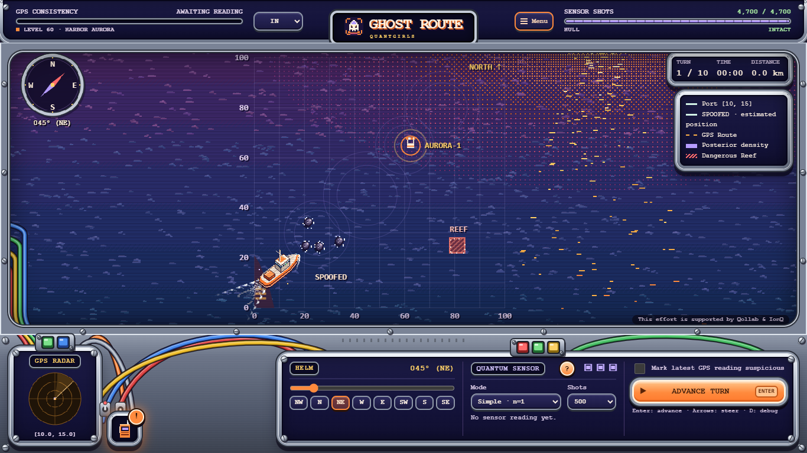

# Aprendizagem do sensor e progressão da campanha

[English](../game-guide.md) · **Português (Brasil)** · [Português (Portugal)](../pt-PT/game-guide.md) · [Español](../es/game-guide.md)

O objetivo educacional continua sendo compreender o sensor: incerteza da amostragem, relação entre assinatura magnética e fase, ambiguidade, combinação de leitura com movimento e comparação de evidências independentes com o GPS. O rádio nas fases calmas sugere variar as medições; o terreno posterior dá um motivo para essas decisões. Os obstáculos são uma aplicação do aprendizado. O navegador continua uma simulação estatística educativa, sem magnetômetro físico ou vantagem quântica demonstrada.

| Primeiro nível | O que muda e o que praticar |
| --- | --- |
| 00 | Quatro turnos guiados: rumo, leitura Simples, comparação GPS e resgate. |
| 01–04 | Prática das mesmas habilidades em mar calmo, sem obstáculos, correntes, ataques ou cartões de novas mecânicas. |
| 05 | Correntes muito leves: medir depois de avançar e corrigir o rumo. |
| 10 | Uma pedra pequena: planejar uma curva suave em mar aberto. |
| 25 | Primeira passagem larga em banco de areia, nas missões com portões. |
| 35 | Um salto curto do GPS: comparar a leitura exibida com o sensor. |
| 45 | GHZ opcional: maior sensibilidade de fase com ambiguidade; Simples continua disponível. |
| 55 | Recife e segunda abertura nas missões com portões. |
| 65 | Apagão na reentrada: usar a elipse prevista até o sinal voltar. |
| 70 | Sinal falso da Aurora: usar evidências independentes da posição, além da aparência. |
| 75 | Deriva do GPS: comparar leituras sucessivas. |
| 85 | Terceira abertura alternada nas missões com portões. |
| 90 | Congelamento do GPS: observar se a posição informada acompanha o navio. |
| 95 | Orientação de orçamento antes dos desafios finais combinados. |
| 99 | Maior pressão conjunta: três passagens estreitas, oito pedras, três tipos de ataque e precisão de resgate exigente. |

Os níveis 01–04 reforçam o uso do sensor ensinado no tutorial 00. As mecânicas entram uma por vez, com pelo menos cinco níveis entre introduções. O destino se desloca suavemente pelo mapa; a incerteza da corrente aumenta, o orçamento diminui e a precisão exigida no resgate cresce gradualmente. A demanda de distância da rota de referência aumenta de cerca de 70% no nível 01 a 92% no 99. Essa referência usa os centros das passagens, não inclui desvios por pedras e não mede sucesso nem garante que todo jogador perceba cada nível adjacente como mais difícil.

As missões com passagens começam no 25. A partir daí, níveis terminados em 5–9 usam portões; os terminados em 0–4 têm mar aberto. Um, dois e três portões aparecem pela primeira vez em 25, 55 e 85. Cada abertura nova começa larga. As existentes estreitam e se deslocam gradualmente, sem inverter de lado a cada nível. Pedras pequenas podem exigir curvas mesmo sem muralhas. A missão final combina os desafios apresentados; as variantes em mar aberto mantêm a pressão de corrente, sensor, ataques e precisão.

Evidência nova: 112 testes Python, nove suítes do frontend, busca de rotas com semente nos 100 níveis e exportações reais do controlador validadas pelo Python. Os testes exigem primeiras fases calmas, uma mecânica nova por vez, intervalo entre introduções, mudanças limitadas nos recursos e configuração final combinada. O navegador cobre quatro idiomas, 21 tamanhos, tutorial de quatro turnos, fases calmas 01–04 e as 12 explicações de mecânicas. Observação humana ainda é necessária para medir compreensão, frustração e dificuldade percebida.

[Ramsey / GHZ](scientific-basis.md) · [QA](qa-report.md)

