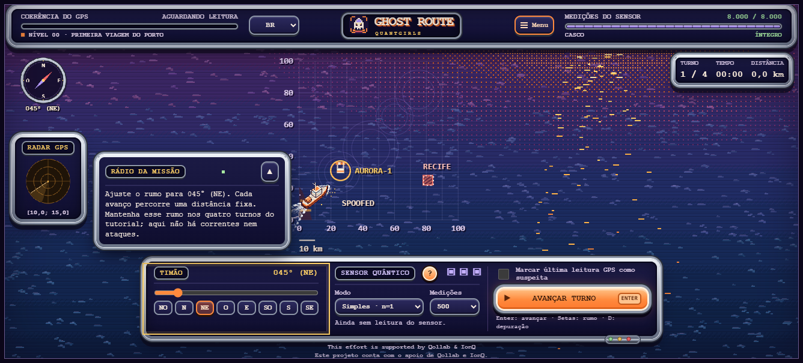

# Relatório de verificação

[English](../qa-report.md) · **Português (Brasil)** · [Português (Portugal)](../pt-PT/qa-report.md) · [Español](../es/qa-report.md)

## Campanha, balanceamento e introduções atualizados — 11 de outubro de 2026

A revisão incorpora o commit `a601779` (portões, bancos de areia e Aurora-fantasma). A comparação de rotas mostrou maior exigência proporcional de distância na fase 01 do que em várias fases posteriores. A margem de deslocamento agora acompanha os centros das passagens alternadas, com demanda de referência gradual de 78% a 92%. É uma métrica de projeto, não uma taxa de sucesso de usuários. As regressões cobrem as 100 configurações, mudanças de recursos entre fases, transições de portões e introduções no momento adequado. A busca de rotas verifica movimentos completos com rumos inteiros, correntes da semente e colisões; conhece o destino oculto, portanto não comprova que um iniciante descobrirá a rota. Sessões com jogadores ainda são necessárias para avaliar dificuldade percebida e compreensão.

Validação nova: 111 testes Python; nove suítes do frontend; navegador nos quatro idiomas em 21 tamanhos, incluindo 1336×605 e 1340×613 do problema relatado, 1366×600 e os dois lados da transição de 1200×640. Os testes do rádio verificam separação de radar, bússola, telemetria e leme, além de estabilidade do mapa e controles ao abrir e fechar repetidamente. Os testes de introdução cobrem 100 fases, primeiro turno afetado, ausência de cartões duplicados, pausa durante explicações, troca de idioma e confirmação salva.

O rádio fica separado do radar GPS, bússola, telemetria e leme. Abrir ou fechar preserva a posição do mapa e dos controles. Em celulares pequenos, ele abre temporariamente sobre o mar; mensagens longas têm rolagem dentro do rádio, e fechá-lo libera a visualização do mapa.

## Revisão atual — 11 de outubro de 2026

As referências científicas, a declaração para submissão e os critérios de produto educacional agora distinguem fundamentos externos da integração original do jogo. Estatística Ramsey/GHZ, localização clássica, mapa sintético e execução Qollab independente estão explícitos.

Corrigidos: rolagem desnecessária no menu inicial de notebooks/celulares comuns, ações duplicadas de início no celular, textos da missão saindo da moldura em telas intermediárias/baixas e botão principal que ignorava um nível recém-selecionado. Reiniciar/exportar ficam em **Ajuda e ações**. A rolagem interna continua disponível em telas muito pequenas/deitadas e na ajuda expandida; o conteúdo do menu não é descartado para esconder a barra.

Validação: **108 testes Python passaram** (Python 3.12, Qiskit 2.5.2); as nove suítes existentes do frontend passaram, incluindo rotas viáveis nos 100 níveis. A ação do nível selecionado tem regressão do controlador. Verificações reais Chromium/Edge cobrem quatro idiomas nas 16 telas abaixo, redimensionamento, rolagem, controles nas molduras, rádio sem cobrir leme e ajuda expandida. A exportação do replay também foi exercitada em celular pequeno. Links da documentação e limites do pacote gerado foram conferidos. Imagens atualizadas a partir de jogo real em inglês.

Telas verificadas: 1920×1080, 1440×900, 1366×768, 1280×720, 1200×640, 1024×768, 900×600, 899×700, 851×600, 768×1024, 390×844, 390×667, 360×640, 320×568, 844×390, 667×375.

Execute `tests/browser-layout.cjs` opcional conforme o guia técnico. Isso não comprova acessibilidade exaustiva, aprendizagem, todos os aparelhos/níveis de zoom, implantação em produção ou execução Qollab/IonQ. Links da plataforma, evidência de backend, vídeo e submissão formal continuam dependendo da equipe/conta.

## Verificação anterior — 10 de outubro de 2026

Revisão em 2026-10-10: frontend, giro do navio, walkie-talkie, campanha gradual e documentação nos quatro idiomas.

| Área verificada | Evidência |
| --- | --- |
| Regras | Encalhe, orçamento, marcações de leituras observadas, exportação JSON e resgate antigo. |
| Estimador | Transporte fracionário, conservação da probabilidade nos limites e regiões de credibilidade. |
| Traduções e interface | Quatro catálogos, variáveis, ligações HTML, resgate do tutorial, progresso salvo, repetição e reinício. |
| Campanha | As 100 configurações admitem resgate seguro com movimentos fixos, rumos inteiros e correntes com sementes definidas. |
| Navio | 64 perspectivas distintas, limites íntegros, mastro em pé, mudanças rápidas de rumo, passagem pelo norte e estabilização. |
| Mapa e experiência | Cinco configurações de projeção; nomes, introduções, sons sintetizados, silêncio e áudio indisponível. |

O navegador foi testado com giro contínuo e abertura/fechamento do rádio em 1440×900, 1366×768, 1024×768, 900×600, 844×390, 390×844, 390×667 e 768×1024, nos quatro idiomas. Foram incluídos encalhe e os dois alertas; o rádio não cobriu os controles e nenhum erro de execução foi registrado.

A documentação foi verificada quanto a links relativos, idiomas, caminhos e conteúdo dos pacotes. As imagens do README são capturas reais em inglês.

## Limites das evidências

Rotas possíveis não medem dificuldade percebida. Formações estáveis, crescimento gradual e restrições monotônicas de recursos precisam de partidas com jogadores para ajustes finos. Gerar áudio não certifica a qualidade subjetiva; testar teclado não certifica acessibilidade.

O backend Python não foi alterado nem testado novamente nesta etapa. Documentos antigos registravam 105 testes Python; a contagem histórica não é um resultado novo. Publicação online e execução Qollab/IonQ precisam de evidências próprias.

[Guia técnico](technical-guide.md) · [Central de documentação](README.md)

This effort is supported by Qollab & IonQ

## Verificação dos tutoriais no navegador

`tests/browser-onboarding.cjs` verifica o resgate real nos quatro turnos do nível 00, cartões traduzidos, pausa durante explicações e sequência dos diálogos do sensor e das mecânicas em 1336×605, 390×667, 320×568 e 667×375, nos quatro idiomas. Execute com a mesma configuração Playwright da suíte de layout.

