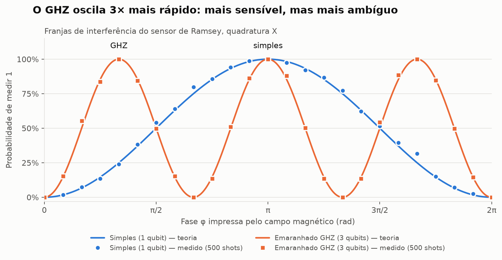

# Technical guide

**English** · [Português (Brasil)](pt-BR/technical-guide.md) · [Português (Portugal)](pt-PT/technical-guide.md) · [Español](es/technical-guide.md)

**Reproduce the model, run the checks and keep browser simulation separate from circuit execution.** Commands below run from the repository root.

## Three execution paths

| Path | What executes | Evidence it provides |
| --- | --- | --- |
| Browser | HTML/CSS/Canvas and JavaScript sampling of analytical Born probabilities. | Playable missions and exported decisions; no Qiskit or hardware job. |
| Local Python | [sensor.py](../sensor.py) and Qiskit simulation; optional JSON circuit replay. | Circuit/model comparisons on the local backend used. |
| Qollab | [main.py](../main.py) with the platform-injected backend. | Only an actual platform run establishes execution there. |

## Sensor model

A toy magnetic field maps position to phase φ. Measurements in X and Y use:

~~~text
P_X(1 | φ, n) = (1 − cos(nφ)) / 2
P_Y(1 | φ, n) = (1 − sin(nφ)) / 2
~~~

Simple uses n=1; GHZ uses n=3 and three entangled qubits. The threefold phase response also creates three candidate phases. A scalar field reading alone cannot identify a unique two-dimensional position. The Bayesian grid combines its likelihood with predicted movement. The 95% credible region tests consistency, not the probability that GPS is honest.

## Browser and frontend checks

Open [public/index.html](../public/index.html), or serve public with <code>python -m http.server 8000 --directory public</code>. No build or frontend package install is needed. Node.js runs the checks:

~~~sh
node tests/game-core.cjs
node tests/estimator.cjs
node --test tests/localization.cjs
node tests/ui-state.cjs
node tests/campaign.cjs
node tests/ship-rendering.cjs
node tests/map-layout.cjs
node tests/experience.cjs
node tests/progression.cjs
~~~

The campaign search checks full movement segments, fixed travel distances, integer headings and seeded currents. It does not measure perceived difficulty or learning outcomes.

## Local Python setup

Use Python 3.10 or newer and the dependencies in [requirements.txt](../requirements.txt). Qiskit is constrained to >=2.5.2 and <3; other dependency versions are not pinned.

~~~sh
python -m venv .venv
~~~

**Windows:** <code>.venv\Scripts\activate</code>  
**macOS / Linux:** <code>source .venv/bin/activate</code>

~~~sh
python -m pip install -r requirements.txt
python sensor.py
python -m pytest tests -q
python scripts/plot_fringes.py
~~~

On Windows, [setup_and_test.bat](../scripts/setup_and_test.bat) provides the setup workflow. The fringe script regenerates the illustration above.

## Export and replay

Browser exports preserve positions, phases, commands, measurements and campaign configuration. Python replay validates the recorded world and takes **fresh samples** at saved phases. Python and JavaScript use different random-number generators; identical seeds do not imply identical measurement counts.

~~~sh
python scripts/replay_session.py examples/session-seed-20261011.json
python scripts/replay_session.py examples/session-level-00.json --validate-only
python scripts/replay_session.py examples/session-level-00.json --output dist/replay-report.json
python scripts/package_qollab.py
~~~

Archived 1.0.0 and campaign 1.1.0 exports are supported. The archived example retains the original twelve-turn mission; it is not the current difficulty configuration for every level. <code>--validate-only</code> submits no circuit job. Actual replay batches circuit PUBs in one sampler.run call. This multi-circuit replay is distinct from the Qollab entry point.

## Qollab entry point and package

<code>main.py</code> combines Simple/GHZ X/Y readings into **one eight-qubit circuit and one backend.run call**. It relies on the injected backend, does not select one during import and does not call main manually. Generate the package, preserve its root and follow the platform's current runtime workflow. Output is ignored <code>dist/qollab/</code> and <code>dist/ghost-route-qollab.zip</code>. Confirm actual execution and public links using the [submission checklist](submission-checklist.md).

## Static hosting and source map

For Vercel, the repository's [vercel.json](../vercel.json) serves **public/**: framework Other, no build command, repository root. The Python sensor needs its own execution environment.

| Source | Responsibility |
| --- | --- |
| public/assets/js/engine.js | Physics, campaign configurations, estimation and 64 ship perspectives. |
| public/assets/js/app.js | Controls, replay, localization updates and radio positioning. |
| public/assets/js/i18n.js | Four complete player-facing catalogs. |
| public/assets/js/onboarding.js | Level names and introductions. |
| public/assets/js/audio.js | Synthesized effects and mute behavior. |
| public/assets/css/game.css | Responsive bridge and walkie-talkie presentation. |
| main.py / sensor.py | Qollab entry point and reusable quantum model. |
| scripts/ / tests/ | Replay, packaging and verification. |

See [verification](qa-report.md) for tested scope. “32-bit” denotes the visual style, not a Windows binary architecture.

[Scientific basis and external references](scientific-basis.md) — Ghost Route is based on real quantum sensing and navigation techniques in an educational, simplified form. The team researched them after reading the Q-CTRL news. The contribution is their integration into a rescue game; the team does not claim to have invented Ramsey interferometry, GHZ states or Bayesian localization.

## Runtime compatibility and browser regression

Verified [Qollab runtime documentation](https://qollab.xyz/learn/docs/runtime-environment) on 11 October 2026: Python imports root modules normally, backend selection is injected, and IonQ permits one job per run. Project limits are 100 files and 2 MB per file. The generated archive is a distribution bundle; preserve its contents/root when uploading. For a minimal Python demonstration upload `main.py`, `sensor.py`, `requirements.txt`, MIT license and explanatory documentation. Do not upload `.venv`, caches or local test output.

`public/index.html` is the externally hosted browser game. It cannot be dropped unchanged into a Qollab JS project: that surface ignores script tags and loads `main.js`/`main.css`. The shipped Qollab entry point is Python. Browser storage and sound behavior on the external host are separate from Qollab's sandbox, which has no persistent local storage.

Optional real-browser layout check: install Playwright locally (`npm install --no-save playwright`, then `npx playwright install chromium`) and run `node tests/browser-layout.cjs`. An existing Chromium/Edge executable can be selected with `PLAYWRIGHT_CHROMIUM_EXECUTABLE`. Playwright is a development dependency, not required to play or run the Python entry point. The test covers all four languages, resizing, menu overflow, selected-level action, controls inside their frames, radio separation and access to expanded help.

Resource counts differ: the browser splits a selected total measurement budget between X and Y. Python `shots` specifies repetitions per quadrature; in `main.py` all four readouts share one circuit repetition. These budgets should not be compared as identical physical costs or used to infer a quantum advantage.

## Updated campaign, balance and onboarding — 11 October 2026

Levels 01–04 reinforce the sensor skills taught in level 00. New mechanics enter one at a time, with at least five levels between introductions. The destination moves gently across the chart; current uncertainty grows, measurement budgets shrink and rescue precision tightens gradually. The reference-route travel demand grows smoothly from about 70% at level 01 to 92% at level 99. This reference uses opening centers, excludes rock detours and does not measure player success or guarantee that every individual finds adjacent levels equally harder.

Passage missions begin at level 25. From then on, levels ending in 5–9 use gates; levels ending in 0–4 use open water. One, two and three gates first appear at 25, 55 and 85. Each new opening starts wide. Existing openings narrow and offset gradually without flipping sides every level. Small rocks can require a curved route even without walls. The final mission combines all introduced challenges; open-water variants retain their current, sensor, attack and precision pressure.

The educational purpose remains understanding sensing: sampling uncertainty, the relationship between magnetic signature and phase, phase ambiguity, combining measurements with movement, and comparing independent position evidence with GPS. Calm radio prompts invite different shot counts; later terrain gives these decisions a reason. Navigation hazards are applications of the lesson. The browser remains an educational statistical simulation, not a physical magnetometer or demonstrated quantum advantage.

Terrain is explained at departure. GPS jumps, blackout, drift and freezing are introduced just before their first affected move. The ghost beacon is explained when it first becomes visible; an attack during blackout may not display it. Play pauses until the player acknowledges the card. Acknowledged mechanics are remembered; skipping to an advanced level still teaches unfamiliar mechanics at the appropriate time. The ghost is a visual GPS deception, not a second physical capsule. Approaching it does not rescue Aurora-1; success requires the real capsule within the configured radius.

The radio stays clear of GPS radar, compass, telemetry and helm. Opening or closing it preserves the chart projection and controls. On small phones it temporarily opens over the sea; long messages scroll inside the radio, and closing it restores the unobstructed chart.

## Browser tutorial verification

`tests/browser-onboarding.cjs` verifies the actual four-turn level 00 rescue, translated cards, pause during explanations and sequential sensor/mechanic dialogs at 1336×605, 390×667, 320×568 and 667×375 in all four languages. Run it with the same Playwright configuration as the layout suite.

[Sensor learning and campaign progression](campaign-design.md)
